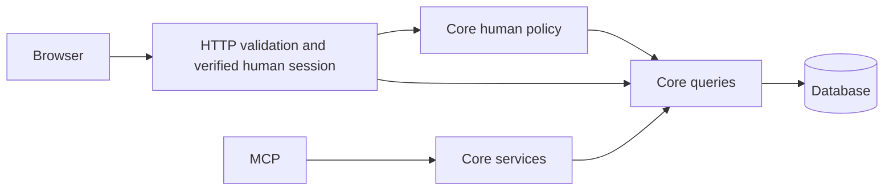

# Human dashboard query boundary

The dashboard and MCP share the Core library. A transport does not need to
call another transport to use its data-access layer.



## Responsibilities

- `memoryhub_core.authorization.human` owns `Principal`, human grants, row
  visibility, content visibility and mutation capabilities. It has no HTTP
  dependency. Human memberships are independent of an owned agent's token
  scopes and project memberships.
- `memoryhub_core.queries` owns SQL construction and execution, tenant
  predicates, joins, pagination and authorized aggregates. Queries return
  domain rows and aggregates; they do not import BFF schemas or HTTP types.
- Core services own shared persistence and transaction-sensitive operations.
  Existing MCP services use the same row, project, entity-mention, child,
  curation-visibility and deletion queries as the human adapters.
- The BFF proves the session identity, validates HTTP input, maps denials to
  HTTP status codes, stages required audit events, controls the request
  transaction and shapes the response. It does not construct SQL or create
  its own database engine. The Core session factory supplies the common
  connection/session configuration.

The `src.authorization.Principal` and `Access` imports remain available to
the BFF. Its `Access` subclass only maps Core policy denials to HTTP errors;
the replacement role resolver in #744 can keep this interface.

## Shared mutation and project operations

Core `update_memory` runs content-rule curation before creating a revision.
HTTP, MCP and direct Core callers share that invariant. Revision checks
skip duplicate gates and weight-only updates, and seed rules without
committing the caller's transaction. A veto raises `CurationBlockedError`;
the HTTP adapter maps it to 409 and MCP uses its existing curation-veto
error prefix. Adapters do not run a parallel curation pipeline.

`prepare_memory_delete` and `stage_memory_delete` are the common preflight
and persistence operations for single HTTP, bulk HTTP and Core/MCP deletion.
Preflight locks the full closure, checks relationship integrity, and accepts
the caller's authorization predicate. Already deleted intermediates remain
in the traversal but are excluded from mutation, authorization of changes,
counts and S3 cleanup. Staging does not commit; required audit rows and all
bulk changes commit together. Core's single-delete wrapper retains external
storage cleanup after commit when an S3 adapter is supplied.

Project lists use one Core selection with explicit member/open/all visibility
and common batched membership and memory aggregates. UI enriches the result
with campaigns and member totals, without per-project database calls. The UI
list uses four SELECTs and the Core/MCP list three, independent of list size.
Both exclude already deleted memories from project counts.

## Shared selection and preflight

`MemoryFilters` and `memory_conditions` define the selection used by browse,
graph and export. Filters narrow the authorized set; text, domain and entity
filters cannot inspect content hidden by the human policy. Counts and graph
connectivity are computed from authorized rows. Facet and tab counts retain
their existing contract of describing the authorized base set.

The recursive `delete_closure` is used by both read-only `can_delete`
calculation and Core deletion. Both walk versions in each direction and
descendant branches, traverse deleted intermediates, stop at tenant
boundaries, and terminate cycles with `UNION`. Mutation preflight locks the
underlying memory rows and repeats the selection until the locked set is
stable, including children committed while waiting for a lock. Capabilities
acquire no write locks. Each live row
is still authorized before a mutation. Required audit and mutation writes
remain in the same transaction.

Entity edit capabilities and entity mutation preflight use one source-set
query and row policy. A mutation additionally rechecks live project
membership under lock. Missing or cross-tenant source relationships are
rejected instead of being silently removed from the affected set.

## Deployment context and Route trust

`human-access.sh` defaults to `mcp-rhoai`; `MEMORYHUB_CONTEXT` or `--context`
can select another cluster. An empty explicit context fails before any
cluster call. Every `oc` invocation receives that context. The operator's
current kubeconfig context is not consulted.

The Route health check verifies TLS and hostname. `verify-route.sh` obtains
the public ingress CA from `openshift-config-managed/default-ingress-cert`
in the selected context, or uses system trust when that bundle is not
available. The service CA used for reencrypt behind the router is separate.
OpenShift documents the ingress bundle in its
[certificate documentation](https://docs.redhat.com/en/documentation/openshift_container_platform/4.21/html/security_and_compliance/certificate-types-and-descriptions).

For a custom ingress certificate, supply its trusted PEM bundle explicitly:

```bash
MEMORYHUB_CONTEXT=my-cluster MEMORYHUB_ROUTE_CA_FILE=/path/to/ingress-ca.pem \
  memoryhub-ui/deploy/deploy.sh
```

An unreadable CA file, certificate validation failure or unsuccessful health
response fails verification. There is no insecure fallback. Temporary CA
files are removed when the health check exits.

## Regression coverage

- Architecture checks reject SQL construction/execution in BFF modules and
  HTTP/BFF dependencies in Core policy/query modules.
- PostgreSQL/pgvector tests cover the existing privacy and authorization
  matrix and compare browse, graph and export selections for both roles.
- Core tests compare capability and mutation closure traversal across
  nested branches, deleted intermediates, cycles and tenant boundaries.
- Stubbed deployment tests cover default/env/CLI context selection and TLS
  trust selection, failures and temporary-file cleanup without cluster writes.
- Core query changes trigger the MCP suite as well as the BFF tests in CI.
- Cross-path tests cover curation vetoes, retained deletion timestamps,
  invalid relationships, rollback and batch project-query counts. MCP tests
  verify the public error contract and suppress notifications on failure.
